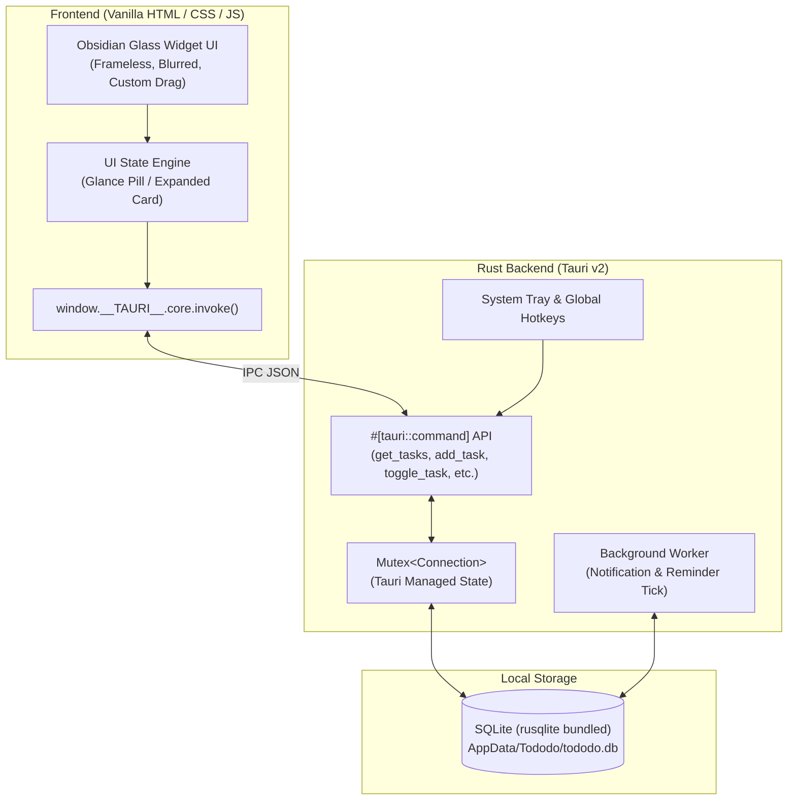

# Tododo — Ambient Desktop Widget Implementation Plan

> **Vision**: A lightweight, distraction-free desktop to-do widget that sits elegantly on your screen. It consumes minimal RAM, opens in milliseconds, looks like high-craft designer software (not a generic utility), and packages into a single one-click installer for anyone to use.

---

## Architecture Overview



---

## Progress Tracking Dashboard

- [x] **Phase 0**: Environment & Developer Toolchain Setup
- [ ] **Phase 1**: Tauri v2 Project Initialization & Vanilla Scaffolding
- [ ] **Phase 2**: Frameless Transparent Desktop Window (The Obsidian Glass Canvas)
- [ ] **Phase 3**: SQLite Engine, Migrations & Managed Rust State
- [ ] **Phase 4**: Rust-to-Frontend IPC Commands (Core CRUD)
- [ ] **Phase 5**: High-Craft Widget UI & Tactile Micro-Interactions
- [ ] **Phase 6**: Dual Form Factor & Elastic "Cloth/Rubber" Stretching Transition
- [ ] **Phase 7**: Organization Power: Priorities, Tags, Pinning & Subtasks
- [ ] **Phase 8**: System Tray, Minimize Behavior & Global Shortcut
- [ ] **Phase 9**: Native Due-Time Notifications & Snooze Background Engine
- [ ] **Phase 10**: Distribution, Small Installer Build & Performance Audit

---

## Detailed Phases

### Phase 0: Environment & Developer Toolchain Setup
*Goal: Ensure your machine has the exact compilers and libraries needed to build native Tauri v2 applications.*

- **What you will learn**:
  - Why Rust compiles down to tiny native machine code without bundling a browser engine like Electron.
  - How WebView2 works on Windows (leveraging the built-in Windows runtime).
- **Deliverables**:
  - [ ] Check / Install `rustup` (Rust compiler & Cargo package manager).
  - [ ] Verify MSVC C++ Build Tools on Windows.
  - [ ] Verify Node.js & npm environment.
  - [ ] Install Tauri v2 CLI (`@tauri-apps/cli`).
- **How to verify**:
  ```powershell
  cargo --version
  rustc --version
  node --version
  npx tauri --version
  ```

---

### Phase 1: Project Initialization & Vanilla Scaffolding
*Goal: Create a clean, unbloated project structure with no heavy frontend frameworks.*

- **What you will learn**:
  - The anatomy of a Tauri v2 app: `src-tauri` (Rust core) + `src` (Web UI).
  - How `tauri.conf.json` defines window configurations, capabilities, and security permissions.
  - Why zero-bundler vanilla JS is lightning-fast and has zero compilation overhead.
- **Deliverables**:
  - [ ] Initialize Tauri v2 with vanilla HTML/CSS/JS template.
  - [ ] Configure `Cargo.toml` with `rusqlite` (`features = ["bundled"]`) and Tauri plugins.
  - [ ] Setup `withGlobalTauri: true` so the frontend easily accesses `window.__TAURI__`.
- **How to verify**:
  ```powershell
  npm run tauri dev
  ```
  *A bare native desktop window should launch in under 2 seconds.*

---

### Phase 2: Frameless Transparent Desktop Window (Obsidian Glass Canvas)
*Goal: Transform a regular desktop window into a sleek, floating desktop widget that feels like part of your wallpaper, with freely adjustable sizing and positioning.*

- **What you will learn**:
  - How Windows handles frameless windows, alpha-transparency, and window shadows.
  - Using `data-tauri-drag-region` and custom drag handles to move the window anywhere on screen.
  - Making window components modular and freely resizable by the user.
  - Using CSS `backdrop-filter: blur(24px)` to achieve real glassmorphism over desktop wallpaper.
- **Deliverables**:
  - [ ] Configure `tauri.conf.json`:
    - `transparent: true`
    - `decorations: false`
    - `alwaysOnTop: true` (toggleable)
    - `shadow: true`
    - Default size `340px × 520px`, with user-adjustable resize edges.
  - [ ] Create the CSS Obsidian Glass theme:
    - Deep charcoal base (`#0c0e14` with `85%` opacity)
    - Hairline luminous borders (`rgba(255, 255, 255, 0.08)`)
    - Smooth rounded corners (`16px`)
  - [ ] Screen-freedom controls:
    - Freely drag the widget anywhere on the monitor.
    - User-adjustable width/height with persistent coordinates saved to SQLite.
    - Custom window controls: Pin on top, minimize to tray, opacity slider.
- **How to verify**:
  - Drag the window across different monitors and wallpapers; resize borders smoothly without visual tearing.

---

### Phase 3: SQLite Engine, Migrations & Managed Rust State
*Goal: Implement a reliable, offline-first local database stored in the OS AppData folder.*

- **What you will learn**:
  - How `app.path().app_data_dir()` finds `C:\Users\<User>\AppData\Roaming\<App>` automatically.
  - Why `Mutex<Connection>` in Tauri `manage()` enables safe multi-threaded access without race conditions.
  - How a `schema_version` table allows seamless database updates without breaking user data.
- **Deliverables**:
  - [ ] Write `src-tauri/src/db.rs`:
    - Initialization of SQLite database file.
    - Migration system with version tracking.
    - Tables: `tasks`, `lists`, `tags`, `task_tags`, `subtasks`, `settings`.
  - [ ] Seed default settings (theme: dark, opacity: 85, sound_enabled: true).
- **How to verify**:
  - Inspect SQLite database creation in `%APPDATA%/Tododo/tododo.db` using a SQLite viewer or terminal command.

---

### Phase 4: Rust-to-Frontend IPC Commands (Core CRUD)
*Goal: Build the secure bridge connecting user clicks to SQLite queries.*

- **What you will learn**:
  - How Tauri `#[tauri::command]` functions accept typed arguments and return `Result<T, String>`.
  - How `invoke('add_task', { ... })` passes messages over asynchronous native IPC.
  - The principle of "Single Source of Truth": UI never keeps unsynced duplicate state; it re-queries on mutation.
- **Deliverables**:
  - [ ] Implement Rust commands in `src-tauri/src/commands.rs`:
    - `get_tasks(filter)`
    - `add_task(title, priority, list_id, due_at)`
    - `toggle_task(id)`
    - `update_task(id, ...)`
    - `delete_task(id)`
  - [ ] Connect vanilla JavaScript controller in `src/app.js` using `safe textContent` (zero `innerHTML` vulnerabilities).
- **How to verify**:
  - Add a task, check it off, and delete it. Close the app and relaunch—data persists instantly.

---

### Phase 5: High-Craft Widget UI & Tactile Micro-Interactions
*Goal: Elevate the app from a basic to-do list into a visually stunning, dopamine-driven workspace.*

- **What you will learn**:
  - Crafting custom SVG checkboxes with smooth CSS spring bezier curves (`cubic-bezier(0.16, 1, 0.3, 1)`).
  - Micro-animations for task completion (strike-through line animation and gentle fade).
  - Optional soft mechanical sound feedback using Web Audio API (synthesized pop/tick, zero external audio files needed).
- **Deliverables**:
  - [ ] Section grouping:
    - **Focus Now** (Pinned & Overdue)
    - **Today's Tasks**
    - **Completed** (collapsed by default with one-click toggle)
  - [ ] Inline task creator:
    - Press `Enter` to add instantly.
    - Natural typing shortcuts (`!high`, `!med`, `#work`).
  - [ ] Double-click inline editing on any task title.
- **How to verify**:
  - Test the tactile feedback: adding 5 tasks in under 10 seconds via keyboard alone, checking off tasks, and enjoying the fluid micro-animations.

---

### Phase 6: Dual Form Factor & Elastic "Cloth/Rubber" Stretching Transition
*Goal: Morph smoothly between the expanded desktop canvas and the mini widget strip using fluid, rubber-band spring physics.*

- **What you will learn**:
  - How to create an elastic, organic morph animation using CSS spring physics (`cubic-bezier(0.34, 1.56, 0.64, 1)`) and FLIP (First, Last, Invert, Play) techniques.
  - How to coordinate Tauri window dimension transitions (`set_size` / `set_position`) with CSS clip-path morphing so the transition feels like flexible cloth or stretching rubber rather than an abrupt resize.
- **Deliverables**:
  - [ ] **Glance Pill Mode** (300px × 44px):
    - Ambient strip showing top priority task, mini ring progress (`3/5`), and expand handle.
  - [ ] **Expanded Desk Canvas** (340px × 520px+):
    - Full interactive tasks, notes, subtasks, and filters.
  - [ ] **Elastic "Cloth / Rubber Stretching" Morph**:
    - As the user toggles between modes, the card stretches vertically and horizontally with a subtle bounce overshoot before settling into place.
    - Content fades and slides with staggered spring motion.
  - [ ] Opacity slider (adjust from 60% translucent glass to 100% solid obsidian).
- **How to verify**:
  - Click the collapse/expand trigger or press `Tab`: observe the rubber-band elastic morph—it stretches smoothly like cloth rather than snapping rigidly.

---

### Phase 7: Organization Power: Priorities, Tags, Pinning & Subtasks
*Goal: Give you deep structure for your tasks without cluttering the compact widget layout.*

- **What you will learn**:
  - Building collapsible task detail accordions inside a tight 340px width.
  - Subtask completion progress calculations (`3 of 4 done`).
  - Drag-and-drop task reordering using native HTML5 drag events or lightweight mouse tracking.
- **Deliverables**:
  - [ ] Priority indicators (High: vibrant red/coral, Medium: amber, Low: cool blue).
  - [ ] Tag filtering pills at top of widget (`All`, `Work`, `Personal`, `Urgent`).
  - [ ] Pin task to top (persisted in SQLite `pinned` column).
  - [ ] Subtask checklist with automatic parent progress bar.
- **How to verify**:
  - Create a multi-step task with 3 subtasks; see the progress bar update in real-time as subtasks are ticked.

---

### Phase 8: System Tray, Minimize Behavior & Global Shortcut
*Goal: Turn the widget into an omnipresent desktop utility that is always one keystroke away.*

- **What you will learn**:
  - Configuring the Windows System Tray menu with Tauri v2 (`tray-icon` plugin).
  - Registering global OS-level shortcuts (`global-shortcut` plugin).
  - Intercepting the window close event to hide to tray instead of quitting.
- **Deliverables**:
  - [ ] Custom SVG/PNG tray icon with context menu:
    - *Show / Hide Widget*
    - *Quick Add Task*
    - *Pin on Top [✓]*
    - *Quit Tododo*
  - [ ] Global shortcut: `Ctrl + Shift + Space` (or `Ctrl + Shift + A`) instantly summons the widget to your current mouse position or screen corner.
  - [ ] Autostart toggle in settings (launch with Windows on boot).
- **How to verify**:
  - Minimize the app; press `Ctrl + Shift + Space` anywhere in Windows—the widget immediately pops up.

---

### Phase 9: Native Due-Time Notifications & Snooze Background Engine
*Goal: Never miss a critical task deadline with smart OS notifications.*

- **What you will learn**:
  - Running a lightweight Rust background thread (`tokio` / `std::thread`) that sleeps and checks due dates.
  - Triggering native Windows notifications via Tauri notification plugin.
- **Deliverables**:
  - [ ] Background polling thread checking SQLite `due_at` and `snoozed_until` every 30 seconds.
  - [ ] Native Windows Notification banner when a task is due:
    - "Mark as Complete" action button.
    - "Snooze 10m" action button.
- **How to verify**:
  - Set a task due 1 minute from now, wait for the Windows notification popup, and click "Mark as Complete".

---

### Phase 10: Distribution, Small Installer Build & Performance Audit
*Goal: Package the app into a sleek, lightweight installer that anyone can download and run.*

- **What you will learn**:
  - How Tauri bundles your app into an `.msi` or `.exe` installer.
  - Compiler optimization flags (`opt-level = "z"`, `lto = true`, `codegen-units = 1`) to shrink binary size.
  - Measuring true memory footprint using Windows Task Manager / Resource Monitor.
- **Deliverables**:
  - [ ] Configure `release` profile in `Cargo.toml` for maximum size and speed optimization.
  - [ ] Build the standalone production installer with `npm run tauri build`.
  - [ ] Verify that RAM consumption stays strictly under **40 MB** at idle.
  - [ ] Generate README with screenshots and download instructions.
- **How to verify**:
  - Run the generated installer on a clean machine; app installs in under 5 seconds and starts running immediately.

---

## Moving Forward: Step-by-Step

We will execute this plan **one phase at a time**.
Before each step:
1. I will explain **what** we are doing and **why** the architecture works this way.
2. We will implement the code together.
3. We will run it, test it, and verify that you understand every part before advancing.
